# Resumo

O projeto OBotBarato apresenta um sistema desktop para uma perfumaria fictícia, desenvolvido em Java Swing com persistência PostgreSQL. A aplicação reúne catálogo de cosméticos, atendimento no balcão, compra pelo cliente, estoque, acompanhamento de pedidos e consultas gerenciais. Administrador, vendedor e cliente possuem permissões distintas, verificadas também nas operações de banco. Compras, pagamentos simulados, baixas e cancelamentos são registrados em transações para conservar a integridade do estoque e do histórico.

A versão entregue inclui cadastro de usuários e clientes, produtos com imagens, categorias, favoritos, carrinho, cupons, perfil, avaliações de compras verificadas, notificações internas, dashboard e exportação CSV. A busca aceita acentos ausentes, letras maiúsculas ou minúsculas, partes do nome e palavras em qualquer ordem. O projeto é executado e depurado pelo VS Code, com tarefas para compilação, preparação do banco e testes. A demonstração possui trinta produtos e uma carga fictícia de movimento diário, reproduzível em uma instalação nova.

A documentação descreve os requisitos implementados, as regras de negócio, os modelos e o esquema efetivo do banco, além dos procedimentos de validação e execução. Os testes em PostgreSQL real verificam integridade, permissões, concorrência, migrações e fluxos Swing. Pagamento e entrega são simulações acadêmicas; não há integração bancária, site público ou emissão fiscal.

Palavras chave: sistema desktop; perfumaria; Java Swing; PostgreSQL; estoque; pedidos.

<!-- página -->
# 1 Introdução

Uma perfumaria precisa registrar seus produtos, atender clientes, acompanhar vendas e conhecer o estoque disponível. Quando essas informações ficam separadas, o atendente pode consultar um saldo desatualizado, registrar valores inconsistentes ou perder o histórico de uma compra. O OBotBarato organiza essas operações em uma aplicação única, com dados persistidos em banco relacional.

O objetivo geral é desenvolver e apresentar um sistema desktop funcional para o contexto de uma perfumaria fictícia. Os objetivos específicos são manter cadastros, controlar movimentações de estoque, permitir compras e vendas no balcão, acompanhar pedidos, aplicar permissões por perfil e produzir consultas gerenciais coerentes com os registros de venda.

O trabalho utiliza Java 17 como nível de compilação, Swing para a interface, JDBC para comunicação e PostgreSQL para persistência. O estilo branco e azul das telas originais foi mantido. A entrega é exclusivamente desktop: a área denominada Loja é uma janela Swing para o cliente, e não um site disponível na internet.

A construção foi acompanhada por testes automatizados de banco e interface. Os documentos, diagramas e instruções desta versão descrevem as funcionalidades presentes na implementação. A matriz de rastreabilidade relaciona cada requisito à sua tela, código, tabelas e testes, permitindo conferir o conteúdo durante a revisão e apresentação.

O escopo compreende a simulação acadêmica de pagamentos e de entrega. Não inclui cobrança financeira, emissão de nota fiscal, transportadora, envio de e-mail ou SMS, estorno financeiro ou devolução após envio. Esses limites são parte do contexto de uso e não são apresentados como funcionalidades existentes.

<!-- página -->
# 2 Empresa e contexto de uso

OBotBarato LTDA é a empresa fictícia utilizada como contexto do projeto acadêmico. Atua, no cenário proposto, com perfumaria e cosméticos. O nome identifica a aplicação e seus produtos de demonstração, sem representar resultados de uma empresa real.

As atividades simuladas compreendem a organização de categorias e produtos, atendimento de clientes, venda para retirada imediata, compra pela área do cliente, acompanhamento da entrega e consulta de indicadores. A equipe utiliza o painel gerencial; o cliente navega pela loja desktop e acessa apenas seus próprios dados e pedidos.

O administrador mantém os cadastros e configurações que exigem maior privilégio. O vendedor atende clientes e acompanha as vendas. O cliente pode criar uma conta, consultar produtos, montar o carrinho, comprar, atualizar seu perfil e avaliar produtos elegíveis. A separação de funções permite demonstrar o uso cotidiano do sistema sem oferecer a todos os perfis as mesmas operações.

O catálogo fictício contém trinta itens distribuídos em cinco categorias: perfumaria, maquiagem, cuidados faciais, cuidados capilares e cuidados corporais. Cada produto possui nome, descrição, preço, imagem e controle de saldo. As imagens e descrições são materiais de demonstração, sem associação comercial a marcas reais.

A carga de uso diário acrescenta vinte clientes fictícios, sessenta pedidos, dezoito avaliações e quarenta favoritos. Há pedidos de loja e balcão em diferentes estados, incluindo boleto pendente e cancelamento, para permitir uma apresentação com histórico. Essa carga é manual e não se repete automaticamente ao abrir o programa. Reaplicá-la não duplica pedidos, redefine senhas ou repõe saldos.

<!-- página -->
# 3 Ambiente e recursos

## 3.1 Tecnologias e organização

O código usa Java Swing para janelas, formulários, tabelas e navegação. A entrada oficial é view.TelaLoginUnificado. As classes TelaLogin e TelaLojaLogin são aliases de compatibilidade que encaminham à entrada oficial. A identidade da sessão distingue usuário interno e cliente.

Os diretórios src/model, src/dao, src/util e src/view organizam modelos, acesso a dados, serviços utilitários e telas. Os modelos persistentes usam identificadores para relacionar entidades; os DAOs contêm SQL preparado e DTOs de consultas. Operações compostas compartilham a conexão de uma transação por meio de util.Transacao. Não há API web ou servidor de aplicação separado.

O driver PostgreSQL JDBC 42.7.13 está em lib. A compilação usa javac --release 17 e gera o JAR em dist, com a biblioteca JDBC em dist/lib. O inicializador lê as migrations na pasta sql do projeto. Não há dependência de Maven, Gradle, Ant ou NetBeans para executar esta entrega. O VS Code possui configuração de tarefas e depuração em .vscode.

## 3.2 Banco e implantação

O banco deve usar UTF-8. O ambiente validado utiliza Windows, JDK 17 e PostgreSQL 18. Os scripts detectam JDK e PostgreSQL instalados e permitem informar caminhos personalizados. A preparação local cria um cluster próprio, com porta livre, senha aleatória e acesso restrito a 127.0.0.1. O serviço PostgreSQL antigo não é utilizado pela preparação gerenciada.

As migrations V001 a V006 são aplicadas em transações e registradas com checksum em schema_migrations. Arquivos aplicados não devem ser editados. A inicialização da demonstração é separada da instalação do esquema e não apaga cadastros existentes. Configuração real, senhas, clusters e backups são ignorados pelo Git.

<!-- página -->
# 4 Requisitos e regras

## 4.1 Requisitos de acesso e manutenção

| ID | Requisito implementado |
|---|---|
| RF01 | Autenticar administrador, vendedor e cliente; manter sessão ativa e encerrar com saída. |
| RF02 | Criar conta de cliente com nome, e-mail e senha obrigatórios; CPF, telefone e endereço opcionais. |
| RF03 | Ativar ou recuperar acesso por código temporário emitido e entregue manualmente pelo administrador. |
| RF04 | Cadastrar, editar e desativar usuários internos, preservando pelo menos um administrador ativo. |
| RF05 | Cadastrar e editar clientes; administrador desativa ou reativa preservando o histórico. |
| RF06 | Manter categorias e impedir desativação de categoria que possui produtos ativos. |
| RF07 | Manter produtos com categoria válida, descrição, preço, imagem opcional e saldo inicial atômico. |
| RF08 | Consultar estoque e histórico; administrador registra entrada/saída e define mínimo. |
| RF09 | Consultar catálogo ativo, pesquisar partes do nome sem acentos/caixa e aplicar categoria/preço máximo. |
| RF10 | Salvar e remover favoritos associados ao cliente autenticado. |
| RF11 | Montar e ajustar carrinho, com subtotais e uma reserva de checkout por vez. |

As validações de e-mail, CPF, telefone, tamanho de campos e senha são compartilhadas entre telas e DAOs. CPF e telefone, quando informados, precisam ser válidos. Campos opcionais vazios são normalizados para NULL. Desativação conserva o registro e impede uso incompatível com a situação atual.

Todos os termos de uma pesquisa precisam aparecer no nome do produto, em qualquer ordem. A busca não usa sinônimos, correção de digitação ou pesquisa pela descrição. Percentual e sublinhado são literais, e os filtros de ativo, categoria e preço continuam aplicados.

<!-- página -->
## 4.2 Requisitos de venda e acompanhamento

| ID | Requisito implementado |
|---|---|
| RF12 | Confirmar checkout com dados de entrega, revalidação de preço/saldo/cupom e UUID único. |
| RF13 | Registrar PIX, débito, crédito ou boleto simulados; somente admin confirma boleto pendente. |
| RF14 | Vender no balcão com cliente, produtos e quantidades; retirada imediata e dinheiro simulado. |
| RF15 | Consultar pedidos/detalhes/histórico e avançar uma etapa de entrega por vez. |
| RF16 | Cancelar antes do envio, com motivo e devolução única do estoque, conforme o perfil. |
| RF17 | Alterar perfil próprio e senha mediante confirmação da senha atual. |
| RF18 | Manter cupons percentuais, validar período/situação e preservar descontos no pedido. |
| RF19 | Publicar ou editar uma avaliação por cliente/produto comprado, entregue e pago. |
| RF20 | Consultar avisos internos e registrar leitura individual; evitar duplicação por evento. |
| RF21 | Exibir indicadores e gráficos gerenciais coerentes com as vendas e o estoque. |
| RF22 | Consultar relatórios por período e exportar CSV correspondente à consulta exibida. |

Os requisitos não funcionais RNF01, RNF02 e RNF03 tratam, respectivamente, integridade transacional/concorrência, execução e persistência, e interface desktop com navegação e formatos brasileiros. A matriz em docs/MATRIZ_RASTREABILIDADE.md relaciona todos os requisitos ao código e aos testes.

As telas secundárias possuem Voltar; fechar uma janela secundaria conserva a navegação prevista. Datas são apresentadas como dia/mês/ano, com barras inseridas durante a digitação. Valores monetários usam real brasileiro e vírgula decimal. A aplicação mantém operações de gravação protegidas contra repetição durante seu processamento.

<!-- página -->
## 4.3 Regras de compra e pagamento

O carrinho pertence à sessão e permanece em memória até a compra ou saída. Não é uma reserva permanente de estoque. O checkout obtém cópias dos itens e uma chave UUID; bloqueia alterações simultâneas durante a confirmação. Preço, disponibilidade, cliente ativo, categoria e cupom são conferidos novamente no banco.

Valores usam BigDecimal e colunas NUMERIC com duas casas decimais, arredondamento HALF_UP. O desconto percentual do cupom é calculado primeiro. O pagamento incide sobre o valor restante: PIX concede 10%, débito 5%, crédito e boleto não concedem desconto adicional. Dinheiro no balcão também não concede desconto. Exemplo: subtotal R$ 100,00, cupom 10% e PIX resultam em R$ 10,00 de cupom, R$ 9,00 de pagamento e total R$ 81,00.

Pedido, itens, descontos, pagamento, estoque, movimentações, histórico e notificações são gravados na mesma transação. Uma falha desfaz o conjunto. Se a mesma chave já foi concluída, a confirmação retorna o pedido original sem nova baixa. Mudança de preço ou de cupom exige revisão, evitando aplicar silenciosamente condições diferentes das conferidas.

PIX, débito e crédito recebem status confirmado como simulação acadêmica. Boleto permanece pendente até confirmação pelo administrador. Não se solicitam dados de cartão, não se gera cobrança financeira e não se integra um QR Code ou boleto bancário real. Confirmar boleto altera pagamento e histórico, sem baixar o estoque novamente.

Pedido novo da loja nasce aberto, mesmo quando o pagamento já está confirmado. Os dados de destinatário, telefone e endereço são obrigatórios no checkout e ficam gravados como fotografia da entrega. Alterar o perfil posteriormente não muda uma entrega registrada.

Venda de balcão é registrada pela equipe para um cliente ativo e produtos disponíveis. A quantidade digitada é validada antes de adicionar. O pedido já nasce entregue, com origem balcao e pagamento em dinheiro confirmado simulado, representando retirada imediata.

<!-- página -->
## 4.4 Regras de pedido e módulos complementares

A equipe avança a entrega na sequência aberto, em_preparo, enviado e entregue, uma etapa por vez, desde que o pagamento esteja confirmado. Não há saltos, retorno a estado anterior ou reabertura de cancelamento. A operação compara o estado mostrado pela tela com o estado atual; se outro atendimento já alterou o pedido, é necessário atualizar a consulta.

Cliente cancela somente pedido próprio aberto. A equipe pode cancelar aberto ou em_preparo. É obrigatório informar motivo. Pedido e pagamento são cancelados na mesma transação da devolução de todos os itens, inclusive produtos desativados depois da compra. Histórico e valores da venda são preservados; repetição não devolve saldo novamente. Enviado e entregue não são cancelados por esse fluxo.

O perfil é privado e exige senha atual para alteração. Senha nova vazia conserva a existente; senha nova válida e atualização dos dados são atômicas. Alterações revogam códigos de recuperação pendentes. Cupom possui código único, percentual de 0 a 100%, período inclusivo e situação ativa. O pedido guarda o código, percentual e parcelas de desconto aplicadas, sem recalcular compras antigas após editar um cupom.

Avaliação exige produto de pedido próprio entregue e pago, nota de 1 a 5 e comentário opcional. Há uma avaliação editável por cliente/produto. A média e quantidade aparecem no catálogo; a consulta pública não revela nome, e-mail ou CPF do comprador.

Avisos de pedido, pagamento e estoque são internos. A leitura é individual por identidade, inclusive entre administrador e vendedor. Estoque baixo é quantidade menor ou igual ao mínimo de produto ativo; o alerta é emitido uma vez por episódio e pode ser rearmado pela reposição ou alteração do mínimo. A V006 não fabrica avisos de eventos históricos anteriores à instalação.

<!-- página -->
## 4.5 Regras gerenciais e exportação

Dashboard e relatórios filtram a data de criação do pedido, incluindo o dia inicial e final. Intervalo invertido é recusado. O faturamento líquido soma o total dos pedidos com pagamento confirmado e situação não cancelada, independentemente da etapa da entrega. Pagamentos pendentes e cancelamentos são apresentados separadamente.

O ticket médio é o faturamento líquido dividido pela quantidade de vendas confirmadas válidas. O ranking dos dez produtos mais vendidos considera a quantidade e o valor bruto dos itens dessas vendas, antes dos descontos; por isso sua receita pode diferir do faturamento líquido. Produtos depois desativados permanecem no histórico do ranking. Estoque crítico considera o saldo atual de produtos ativos, independentemente das datas do relatório.

As consultas gerenciais relacionadas usam um snapshot consistente para indicadores, tabelas e exportação. O gráfico diário resume os últimos sete dias do intervalo e o gráfico de situação apresenta os estados dos pedidos. A exportação usa os resultados carregados, sem misturar uma nova consulta com os dados vistos na tela.

CSV é produzido em UTF-8 com BOM, separador ponto e vírgula, datas brasileiras e vírgula decimal. Campos com aspas, separadores ou quebras de linha são escapados. Textos que possam ser interpretados como fórmulas recebem proteção. O arquivo é publicado por temporário, evitando substituir um arquivo válido se a gravação falhar. Exportar é desabilitado quando não há resultado exportável ou a consulta ainda não corresponde ao filtro aplicado.

## 4.6 Casos de uso

O diagrama da página seguinte agrupa as operações da aplicação. Administrador especializa as permissões da equipe disponíveis ao vendedor; o cliente utiliza identidade e dados próprios. Essa relação de papéis não representa herança entre as classes Usuario e Cliente. A matriz de acesso do capítulo 6 detalha as restrições de cada operação.

<!-- página -->
## 4.7 Diagrama de casos de uso

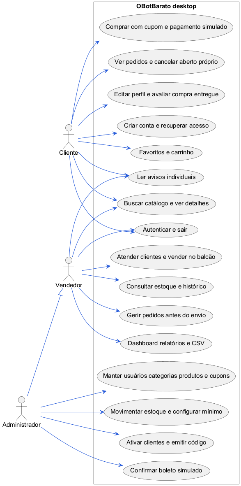

Fonte: dos autores, conforme a versão desktop implementada.

<!-- página -->
# 5 Projeto dos objetos e banco

## 5.1 Classes e acesso a dados

Há sete classes em src/model: Usuario, Cliente, Categoria, Produto, Pedido, ItemPedido e Carrinho. Categoria é um record; Pedido contém a lista de ItemPedido. Relações de produto, categoria e cliente são representadas também por identificadores. ItemPedido usa o nome e preço registrado para representar a linha de uma compra.

Estoque, pagamento, cupom, avaliação, notificação e favorito são conceitos persistidos em tabelas e tratados por DAOs/DTOs; não são apresentados como classes inexistentes em src/model. ProdutoDAO.Disponivel reúne produto, saldo, média e contagem de avaliações. CompraDAO.Resultado representa o resultado da confirmação. GestaoPedidoDAO e RelatorioDAO possuem registros próprios para seus filtros e consultas.

UsuarioDAO e ClienteLojaDAO autenticam as respectivas identidades. ClienteDAO e CategoriaDAO dão suporte à manutenção. ProdutoDAO consulta e grava produtos. EstoqueDAO registra saldo e movimentos. PedidoDAO atende o balcão e consultas de pedido; CompraDAO conduz checkout e pagamento; GestaoPedidoDAO conduz transições e cancelamentos. CupomDAO, AvaliacaoDAO, NotificacaoDAO e RelatorioDAO implementam os módulos correspondentes.

Transacao gerencia commit e rollback de operações compostas. Acesso revalida a autorização no banco. Sessao mantém a identidade em uso; Dinheiro, Datas, MascaraCampo, BuscaTexto, Imagens e Validacao centralizam regras de formato e validação. Tema e Navegacao organizam apresentação e retorno das janelas. As sequências deste capítulo mostram os fluxos centrais com participantes reais do código.

## 5.2 Modelo de classes

O diagrama da página seguinte resume os atributos centrais e as relações dos modelos. Relações pontilhadas indicam referência por identificador, sem afirmar que cada classe armazena um objeto completo da outra entidade. Métodos de acesso e atributos auxiliares foram omitidos para leitura; os arquivos Java são a referência completa.

<!-- página -->
## 5.3 Diagrama de classes

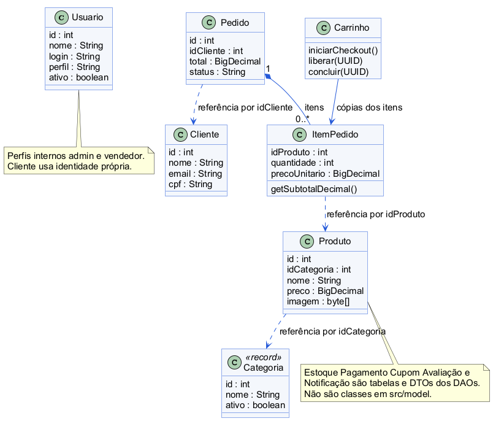

Fonte: dos autores. Representação resumida do código.

<!-- página -->
## 5.4 Estrutura relacional e acesso

O esquema final contém dezesseis tabelas de negócio e a tabela técnica schema_migrations. O DER está dividido em quatro módulos para conservar a leitura. Mostra campos estruturais e chaves; o dicionário docs/DICIONARIO_BANCO.md contém todos os campos, tipos e nulabilidade. As migrations sql/V001 a V006 definem ainda CHECKs, índices, valores padrão e evolução do esquema. Chaves externas ao módulo são indicadas na legenda de cada figura.

Usuarios reúne admin e vendedor; clientes representa a identidade de compra. Acessos_cliente possui uma linha por cliente para o código temporário; sua chave primária também é chave estrangeira para clientes. O código completo não fica salvo, apenas seu hash, validade, tentativas e emissor.

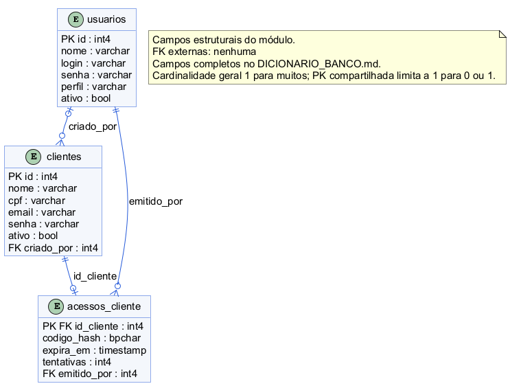

Fonte: dos autores, conferido com o esquema PostgreSQL atual.

<!-- página -->
## 5.5 DER de catálogo e estoque

Categorias agrupa produtos. Estoque usa id_produto como chave primária e estrangeira, com uma linha por produto. Quantidade, mínimo e estado de alerta são separados dos dados comerciais do produto. Movimentos_estoque registra tipo, alteração de saldo, resultado, motivo e responsável; movimentos de venda/devolução podem apontar para o pedido.

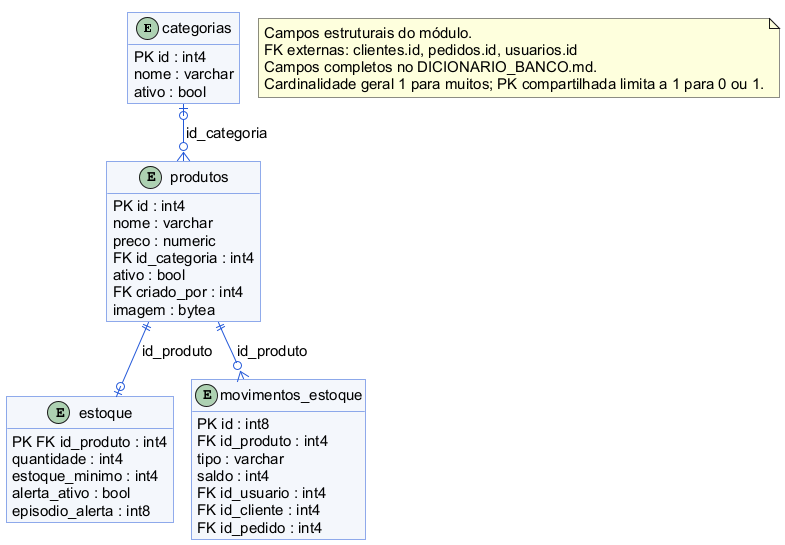

Fonte: dos autores. Imagens são BYTEA; não dependem de caminho pessoal.

<!-- página -->
## 5.6 DER de vendas

Pedidos pertence ao cliente e contém origem, situação, data, total, entrega, UUID e parcelas de desconto. Itens_pedido registra produtos, quantidades e preço unitário. Pagamentos possui id_pedido como chave primária e estrangeira: um pagamento por pedido, sem uma coluna id independente. Historico_pedidos conserva mudanças e responsáveis. Cupons é a configuração atual, enquanto o pedido guarda as condições aplicadas à compra.

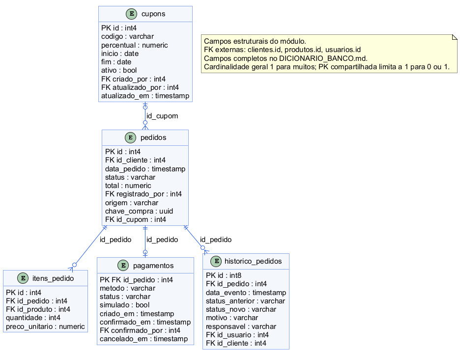

Fonte: dos autores. Campos de entrega/desconto completos no dicionário.

<!-- página -->
## 5.7 DER de experiência do cliente

Favoritos possui chave composta de cliente e produto. Avaliacoes referencia cliente, produto e pedido elegível, com unicidade por cliente/produto. Notificacoes registra destino/evento e referências opcionais à compra ou produto. Leituras_notificacoes registra quando uma identidade leu uma mensagem; não há uma única coluna lida em notificacoes compartilhada entre todos os usuários.

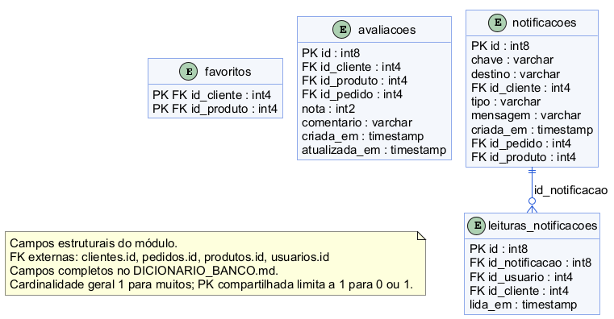

Fonte: dos autores. Leitura é individual e destino do aviso é validado.

<!-- página -->
## 5.8 Sequência de autenticação

O login unificado escolhe a autenticação apropriada, verifica cadastro ativo e senha e inicia a identidade. Hashes legados válidos são substituídos pelo formato atual no login. Falha de conexão é apresentada como falha operacional, sem ser confundida com senha incorreta.

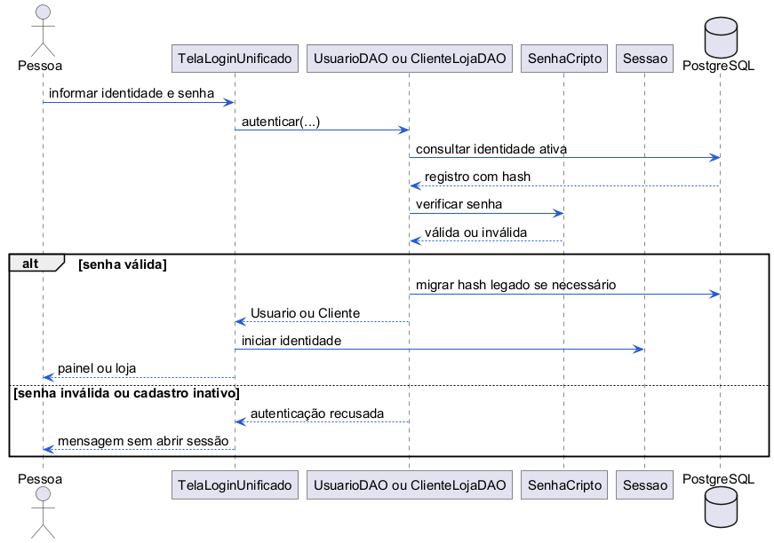

Fonte: dos autores. PBKDF2 é o formato atual, explicado no capítulo 6.

<!-- página -->
## 5.9 Sequência de cadastro de produto

Produto e estoque inicial usam a mesma transação, com movimento de abertura e eventual alerta. Imagem é opcional, validada como PNG/JPEG até 5 MB e 4096 pixels por lado. O formulário mostra sucesso apenas após a conclusão; falha no estoque desfaz também o produto.

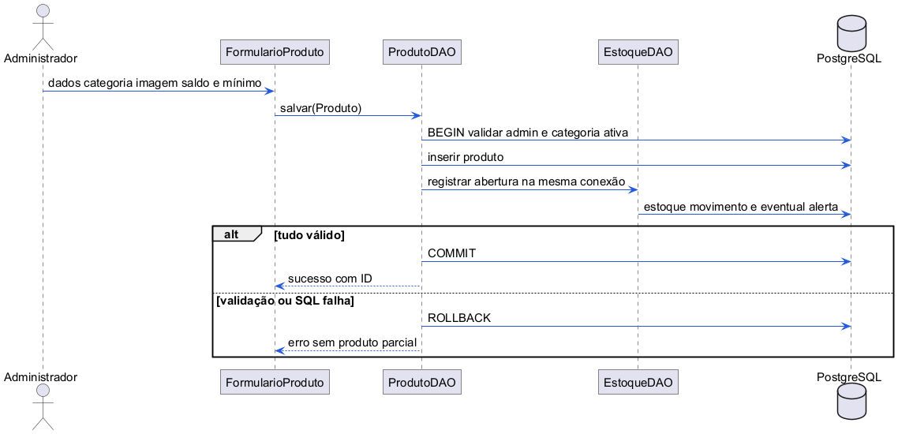

Fonte: dos autores. Categoria e autorização são revalidadas no DAO.

<!-- página -->
## 5.10 Sequência da compra

CompraDAO.confirmar realiza a operação principal; não há um PagamentoDAO separado. Os módulos auxiliares recebem a conexão da transação. Retry retorna a compra original; rollback conserva a possibilidade de revisão do carrinho.

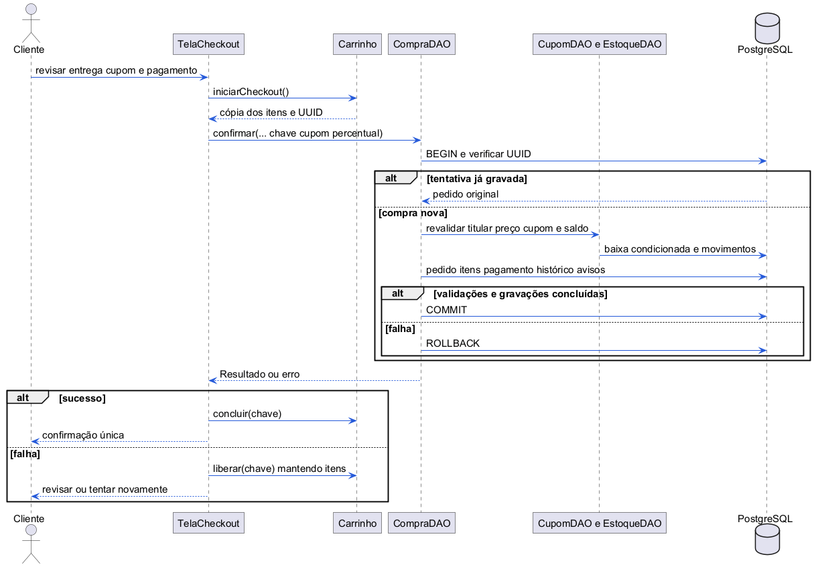

Fonte: dos autores. Pagamento e avisos pertencem à mesma confirmação.

<!-- página -->
## 5.11 Sequência de cancelamento

GestaoPedidoDAO revalida identidade, situação e motivo, e usa EstoqueDAO para devolver saldo na mesma conexão. O histórico é preservado e uma tentativa concorrente encontra o estado já alterado, evitando segunda devolução.

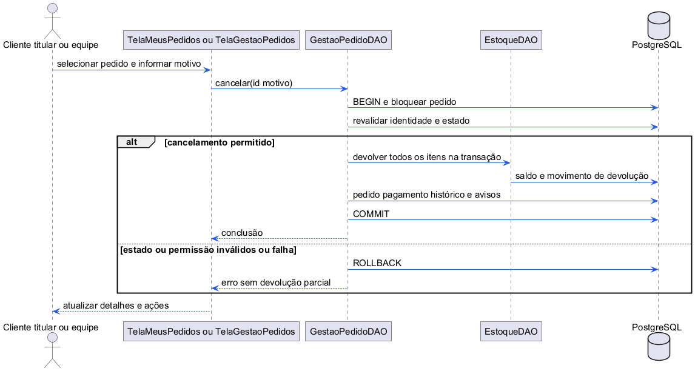

Fonte: dos autores. A gerência também consulta detalhes e avança estados.

<!-- página -->
## 5.12 Sequência de usuários internos

UsuarioDAO controla o conjunto de administradores ativos dentro de transação com advisory lock. Login é normalizado e único. Senha vazia na edição mantém a atual; senha nova recebe hash PBKDF2 com salt. O último administrador não pode ser desativado ou rebaixado.

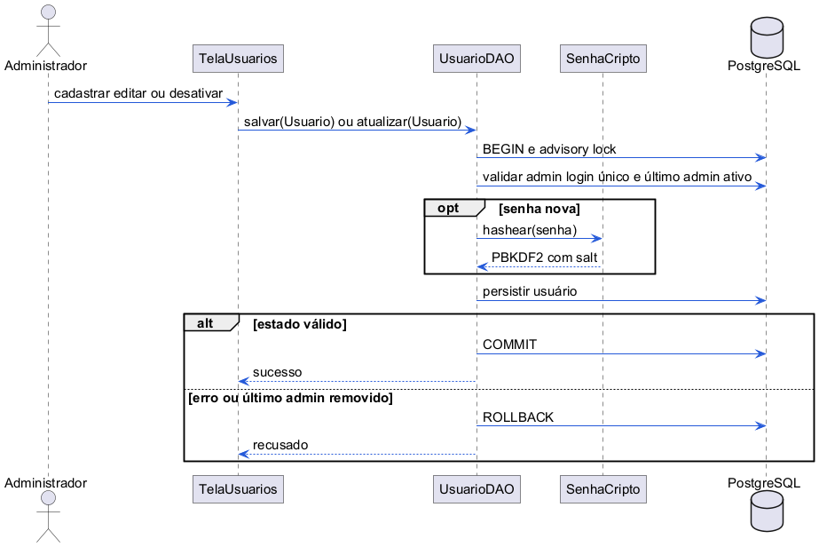

Fonte: dos autores. Permissões de admin são revalidadas na operação.

<!-- página -->
## 5.13 Atividades de pedido

O diagrama resume a compra da loja e sua entrega. Cancelamento continua disponível à equipe também em preparo, antes do envio; boleto pendente pode ser cancelado sem confirmação. Transições, confirmação e cancelamento concorrentes são serializados para conservar um estado coerente.

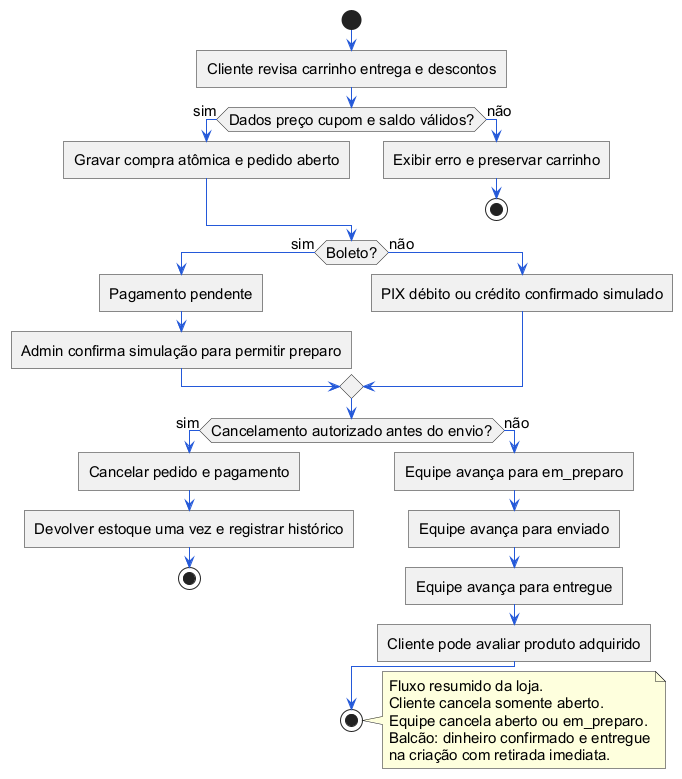

Fonte: dos autores. Retirada de balcão é o fluxo imediato descrito em RF14.

<!-- página -->
# 6 Projeto procedimental e acesso

| Operação | Admin | Vendedor | Cliente |
|---|---|---|---|
| Usuários, categorias, produtos e cupons | Mantém | Não mantém | Consulta catálogo/cupom no checkout |
| Clientes | Cadastra/edita/ativa | Cadastra/edita | Autocadastro e perfil próprio |
| Código de acesso e boleto | Emite/confirma | Não | Utiliza código próprio |
| Estoque | Consulta/movimenta/mínimo | Consulta | Disponibilidade no catálogo |
| Venda e pedidos | Atende e gere | Atende e gere | Compra e acompanha próprios |
| Cancelamento | Aberto/preparo | Aberto/preparo | Próprio aberto |
| Perfil e avaliação | Não usa como cliente | Não usa como cliente | Próprio, com regras de titularidade |
| Avisos | Equipe, leitura própria | Equipe, leitura própria | Destinados ao titular |
| Dashboard e CSV | Consulta/exporta | Consulta/exporta | Não |

Autorização não depende apenas de ocultar botões: Acesso consulta identidade, perfil e ativação no banco. O desktop conecta com uma credencial técnica compartilhada; não há um usuário PostgreSQL distinto por conta da aplicação. Configuração e backup devem ser protegidos no computador de uso.

Senhas novas têm de 8 a 128 caracteres e são armazenadas com PBKDF2-HMAC-SHA256, 600.000 iterações, salt de 16 bytes e resultado de 32 bytes. Hashes MD5 ou SHA256 com salt antigos são migrados após login válido. Não se promete isolamento contra quem possui acesso direto às credenciais técnicas do banco.

Ativação/recuperação usa código aleatório de 128 bits, hash SHA256, validade de 30 minutos, limite de cinco erros de formato válido e uso único. O admin entrega o código após identificar o cliente no atendimento. Conhecer e-mail ou CPF não substitui o código; não existe envio automático por e-mail/SMS.

<!-- página -->
# 7 Interface e validação

## 7.1 Loja e busca

A loja reúne os filtros na lateral e os produtos no conteúdo central, com imagem, preço, disponibilidade e ações. A pesquisa abaixo foi conferida na base local sem alterar vendas ou saldos. Digitando oleo, o produto com nome acentuado aparece, e o filtro também aceita argan oleo.

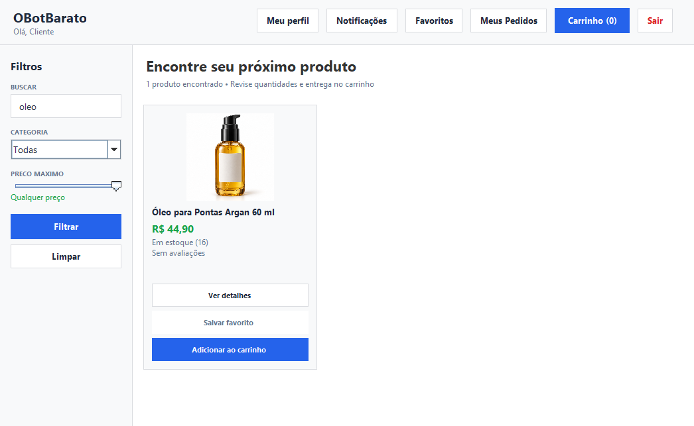

Fonte: captura da aplicação. As imagens são exemplos de estado de tela; novos cadastros e vendas podem modificar quantidades, datas e indicadores.

## 7.2 Cadastro e navegação

O autocadastro indica explicitamente obrigatório e opcional. Campos largos, máscaras, datas brasileiras e botões Voltar nas telas secundárias foram revisados. O carrinho apresenta revisão de quantidade e entrega; ações de pedido são habilitadas conforme a situação e a identidade. O tema e o funcionamento desktop originais foram mantidos.

<!-- página -->
## 7.3 Venda no balcão

A seleção de cliente, produto, quantidade e botão de adicionar fica acima da tabela, sem sobreposição. Produto com estoque pode ser adicionado/removido; a retirada é concluída apenas com itens válidos. CPF ausente é omitido do texto do cliente, sem exibir null. O total é formatado em real brasileiro.

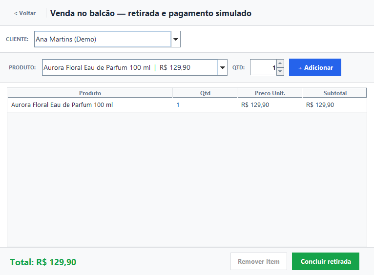

Fonte: captura da aplicação. Durante a gravação, os comandos são bloqueados. Falha conserva os itens para nova tentativa e não informa sucesso sem registro confirmado.

<!-- página -->
## 7.4 Dashboard e histórico fictício

Os indicadores refletem os registros, inclusive a simulação de uso diário. A carga não produz faturamento fora das regras do relatório. Depois de uma nova venda, confirmação de boleto ou cancelamento, os valores mudam ao atualizar. A captura demonstra dados fictícios do ambiente local.

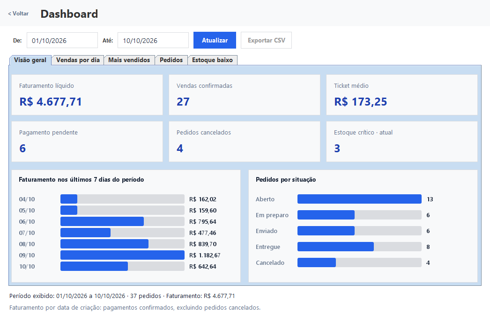

Fonte: captura da aplicação. Cancelados e pendentes ficam separados da receita líquida. O estoque crítico usa o saldo atual, mesmo quando o período de vendas é alterado.

<!-- página -->
## 7.5 Testes e evidências

A regressão integrada em PostgreSQL real verifica 102 cenários numerados dos módulos: 20 de integração básica, 15 de acesso/cadastros, 14 de compra, 17 de gestão/cancelamento, 14 de perfil/cupons, 13 de avaliações/avisos e 9 de relatórios/CSV. O conjunto foi novamente executado na revisão de 11/10/2026.

Oito cenários adicionais de busca verificam acentos, caixa, espaços, fragmentos, palavras fora de ordem, Unicode decomposto, parâmetros preparados e filtro Swing. Nove cenários de carga fictícia verificam autorização, rollback, datas, quantidades, conciliação de saldo e reaplicação sem duplicação. A simulação não é confundida com uso de dados reais.

Também são verificados evolução V001 até V006, checksums, reexecução, importação do catálogo, construção de 23 instâncias de telas e fluxos Swing de checkout, gestão, perfil/cupons, avaliação/avisos, dashboard/CSV e balcão. Vinte e três é a contagem de instâncias do roteiro, incluindo Notificações para duas identidades, e não uma promessa de 23 classes de tela distintas.

Há cenários de duas compras simultâneas da última unidade, confirmação repetida com a mesma chave, transições concorrentes e cancelamento repetido. Falhas injetadas após etapas de SQL verificam rollback de pedidos, itens, estoque, pagamentos, histórico e avisos. Mensagens de falha proposital nesses roteiros são esperadas e não representam defeitos abertos.

Scripts e evidências permanecem em test, scripts e docs/validacao-*.txt. A verificação de persistência reinicia o banco gerenciado, restaura backup em banco novo e confere dados, removendo somente as fixtures próprias. Essas verificações cobrem os cenários executados; não garantem ausência absoluta de falhas em todo computador ou volume de dados.

<!-- página -->
# 8 Execução e apresentação

Instale JDK 17 ou posterior e PostgreSQL. Abra Executar OBotBarato na Área de Trabalho para usar sem o editor. scripts/criar-atalho.ps1 cria os atalhos e deve ser repetido após mover a pasta. O atalho prepara o ambiente, compila quando necessário e inicia javaw sem console permanente. Atalhos locais não são versionados.

Para desenvolver, use VS Code com Extension Pack for Java: abra OBotBarato.code-workspace e pressione F5, selecionando OBotBarato - Desktop. Ctrl+Shift+B compila e Shift+F5 encerra a depuração. As duas formas executam a mesma aplicação e usam os mesmos dados.

Em uma cópia nova, a tarefa OBotBarato: carregar demonstração instala o catálogo e a carga diária, manualmente e com backup. Nesta máquina já foram instalados. Para carregar alterações de código, feche o aplicativo e reabra; sair para o login mantém o mesmo processo Java.

Contas fictícias: admin/admin123, vendedor/vendedor123 e cliente@demo.local/cliente123. A carga usa cliente01@uso.obotbarato.test até cliente20@uso.obotbarato.test, senha demo12345. A preparação conserva senhas alteradas. São contas de demonstração.

A pasta .local/desenvolvimento conserva dados. scripts/backup.ps1 produz backup; scripts/restaurar-backup.ps1 restaura em banco novo, preservando o principal. Configurações reais, backups e dados locais não são enviados ao Git. Banco externo exige base nova UTF-8 e configuração do README; não há conversão automática de dados legados.

O roteiro docs/REVISAO_E_APRESENTACAO.md orienta o ensaio de compra, gestão, avaliação, indicadores e balcão. Documentos e slides estão em docs/final; diagramas têm fonte PlantUML. O pacote em entrega inclui fontes, distribuição e scripts e exige os pré-requisitos instalados. O envio ao GitHub ocorre depois da revisão dos autores.

<!-- página -->
# 9 Conclusão

O OBotBarato reúne em uma aplicação desktop os processos acadêmicos de uma perfumaria fictícia. Cadastros, catálogo, compra pelo cliente, atendimento de balcão, estoque, gestão de pedidos e consultas gerenciais utilizam o mesmo banco. A versão apresenta os módulos complementares de cupons, perfil, favoritos, avaliações e avisos, com regras e permissões explícitas.

A utilização de transações, verificações de estado e chave única de compra permite conservar a consistência dos registros nos cenários de falha e concorrência testados. O histórico registra as operações relevantes e os relatórios distinguem faturamento líquido, valores brutos de itens, pendências e cancelamentos. A busca flexível e os formatos brasileiros ajudam a operar as telas no contexto proposto.

A documentação foi consolidada com o código, as tabelas atuais e as evidências de teste. O projeto pode ser revisado pelo VS Code, com execução, configuração e manutenção descritas. Os produtos e registros de movimento são fictícios e reproduzíveis para a apresentação prevista para 28/10/2026.

O resultado atende ao escopo desktop demonstrado. Pagamento e entrega permanecem simulações; não são afirmados resultados de uma implantação comercial real. Integrações bancárias, emissão fiscal, transportadoras, site público e devolução após envio não fazem parte desta entrega. Algumas consultas administrativas são síncronas e o ambiente depende da instalação de Java e PostgreSQL, conforme os pré-requisitos.

<!-- página -->
# Referências

MICROSOFT. Visual Studio Code documentation: Debugging Java. Disponível em: https://code.visualstudio.com/docs/java/java-debugging. Acesso em: 11 out. 2026.

ORACLE. Java Platform Standard Edition 17 API Specification. Disponível em: https://docs.oracle.com/en/java/javase/17/docs/api/. Acesso em: 11 out. 2026.

POSTGRESQL GLOBAL DEVELOPMENT GROUP. PostgreSQL 18 Documentation: String Functions and Operators. Disponível em: https://www.postgresql.org/docs/18/functions-string.html. Acesso em: 11 out. 2026.

POSTGRESQL GLOBAL DEVELOPMENT GROUP. PostgreSQL 18 Documentation: Transaction Isolation. Disponível em: https://www.postgresql.org/docs/18/transaction-iso.html. Acesso em: 11 out. 2026.

POSTGRESQL JDBC DRIVER. PostgreSQL JDBC documentation. Disponível em: https://jdbc.postgresql.org/documentation/. Acesso em: 11 out. 2026.

OWASP FOUNDATION. Password Storage Cheat Sheet. Disponível em: https://cheatsheetseries.owasp.org/cheatsheets/Password_Storage_Cheat_Sheet.html. Acesso em: 11 out. 2026.

PLANTUML. PlantUML Language Reference Guide. Disponível em: https://plantuml.com/guide. Acesso em: 11 out. 2026.

FELIX DOS SANTOS, Giovana Paula; GUIMARÃES, Samuel da Silva. OBotBarato. Código Java, migrations SQL, testes, documentação e capturas da versão desktop de 11/10/2026. Paranavaí, 2026. Repositório do projeto acadêmico.
